
Your computer deserves a better operating system.



  A secure, polished Linux desktop that updates itself, never nags you, and puts you back in control. Built on Fedora, ready to use.





Windows keeps getting worse.



It's not your imagination. Windows has become a platform that works for Microsoft first and you second.



  
  
  
  
  
  



You deserve a computer that works for you.



tetrataenite is built around a simple idea: your computer should do what you want, quietly and reliably, without getting in your way.



  
  
  
  
  
  
  
  



Pick the one that's right for you.



tetrataenite comes in two desktop flavors. Not sure which to pick? GNOME is a safe default for most people.



  
  
  
  



Ready to make the switch?




